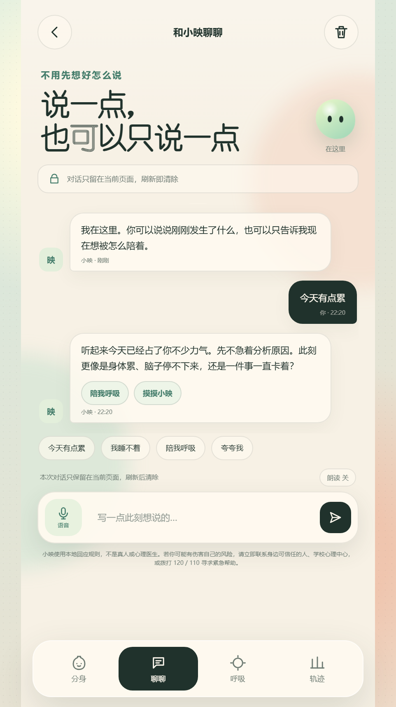

# 映心情绪数字分身

一个移动端优先的交互式网页原型。作品把触摸、语音、手机动作和呼吸练习与数字分身的状态变化连接起来，探索“互动本身也是调节过程”的体验。



## 主要功能

- 触摸或拖动分身，触发姿态、颜色、文案和像素粒子反馈
- 4-2-6、4-4-4、3-3-3 三种呼吸练习节奏
- 浏览器语音识别入口，无法识别时自动进入演示流程
- “聊聊”页面支持连续文字对话、快捷话题、语音输入和可选朗读
- 经用户授权后检测手机摇动，也提供按钮模拟入口
- 手动标记当前状态，不要求长文本或正式量表
- 本地保存互动记录，并生成可下载的情绪卡
- PWA manifest、Service Worker 与移动端安全区适配
- 可选 Cloudflare Workers AI 中文模型，通过后端代理生成更自然的回复

## 本地运行

直接打开 `index.html` 即可体验。需要在手机上测试语音、设备动作和 PWA 时，建议通过本地 HTTP 服务器打开：

```powershell
python -m http.server 8080
```

电脑与手机连接同一局域网后，在手机浏览器访问电脑的局域网 IP 和端口 `8080`。

## 技术实现

- 原生 HTML、CSS、JavaScript
- 内联 SVG 绘制数字分身
- CSS 变量控制状态换色与动效
- Web Speech API 语音入口
- DeviceMotion 设备动作
- Canvas 本地情绪卡
- localStorage 本地记录

## 边界说明

当前版本是可运行交互原型，状态采用可解释规则映射，不构成心理诊断或医疗建议。专用端侧情绪模型与云端视觉生成接口属于后续开发方案。

聊天内容只保存在当前页面的内存中，不写入 localStorage，也不会上传到本项目服务器。语音识别由浏览器提供，部分浏览器可能联网处理音频；本页不提供录音保存功能，用户也可以完全使用文字聊天。

启用云端模型后，当前会话最近 10 条文字会发送给 Cloudflare Worker 代理并用于生成回复；代理由本项目控制，不写入数据库。模型未配置、额度用尽或网络失败时，页面自动退回本地回应。

## 启用中文聊天模型

`worker/` 中包含可直接部署的 Cloudflare Workers AI 代理，默认使用 `@cf/qwen/qwen3-30b-a3b-fp8`。部署完成后，将 Worker 地址填写到 `chat-config.js` 的 `endpoint` 字段。

详细步骤见 [`worker/README.md`](worker/README.md)。

## 目录

```text
.
├── index.html
├── styles.css
├── app.js
├── manifest.webmanifest
├── sw.js
├── assets/
│   └── preview.png
└── README.md
```
